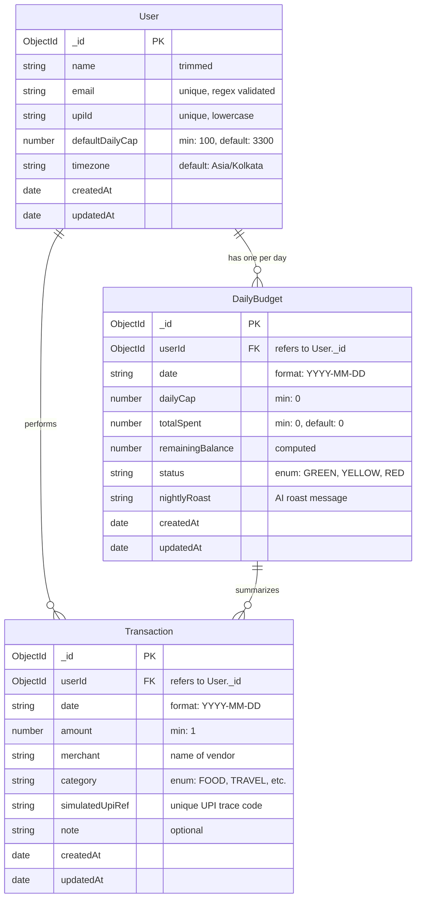
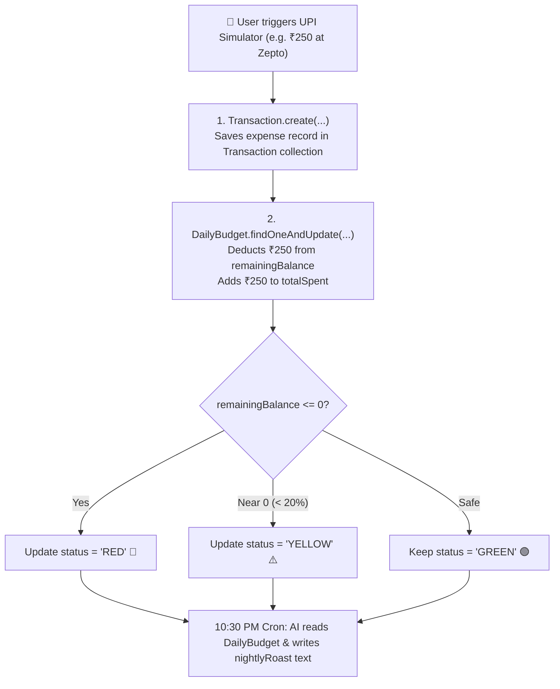

# Architecture & Data Models: UPI Daily Budget & Nightly Roast

This document outlines the entity relationships and data flow across MongoDB Atlas models.

---

## 1. Entity-Relationship (ER) Model

---

## 2. Daily Spend & Deduction Lifecycle

