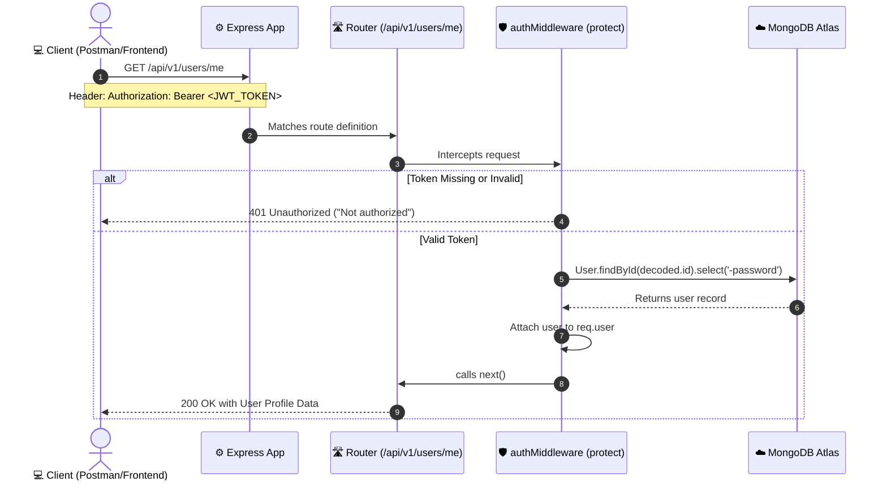

# Day 03: Authentication, Security & Middleware Architecture

## 1. High-Level Concepts Explained Simply

### A. Bcrypt (One-Way Password Hasher)

- **What it is**: A one-way mathematical function that converts a plain text password (like `secret123`) into a fixed-length string of scrambled characters called a hash (e.g., `$2a$10$w8k2J0e7...`).
- **Why we use it**: Passwords must never be stored in plain text. If a database is ever compromised, the attacker only sees irreversible hashes, protecting user credentials.
- **How verification works**: Bcrypt hashes the newly entered password with the exact same stored salt and compares the two hashes. If they match, the password is correct, without ever having to decrypt or reveal the original text.

### B. JWT (JSON Web Token)

- **What it is**: A digitally signed, tamper-proof token containing key user identity details (like `userId`) and an expiration timestamp.
- **Why we use it**: HTTP is stateless (it forgets who you are the moment a request finishes). Instead of requiring a password with every interaction or saving server-side session files, the client sends this token in the header of subsequent requests to prove its identity.
- **How it prevents tampering**: The token is signed using a secret key (`JWT_SECRET`) on the server. If anyone tampers with the user ID inside the token, the cryptographic signature fails, and the request is rejected immediately.

### C. Auth Middleware (`protect`)

- **What it is**: An interceptor function that runs before protected route handlers.
- **Role**:
  1. Inspects the `Authorization: Bearer <token>` header.
  2. Rejects requests lacking a token with HTTP `401 Unauthorized`.
  3. Decodes the token using `jwt.verify(token, process.env.JWT_SECRET)`.
  4. Fetches the user from MongoDB (excluding password) and attaches it to `req.user`.
  5. Calls `next()` to hand execution over to the protected controller.

---

## 2. Request Lifecycle Diagram

